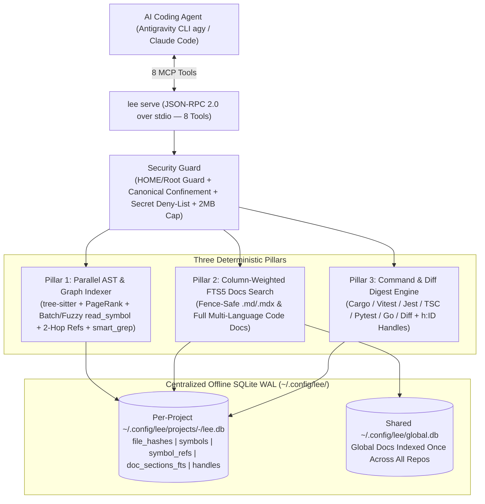

# `lee` — Locate Exact Elements

**Local Token-Saving MCP Server, Multi-Language AST & Markdown Indexer, Named Docs Search, and Output Digest Engine (`h:ID`) for AI Coding Agents.**

`lee` is a single standalone Rust binary engineered to **cut token consumption by 60%–85%** across coding sessions in **Antigravity CLI (`agy`)**, **Claude Code**, and other Model Context Protocol (MCP) clients—with **100% offline execution, zero ML models, and zero network calls**.

---

## 1. Three Deterministic Pillars of Token Savings

1. **Pillar 1 — Precision AST, Config & Markdown Index (`tree-sitter` + PageRank Graph + `blake3` Parallel Indexing):**
   Extracts symbol signatures for Rust, TypeScript/JS, Svelte, Python, and Go; key ranges for `.toml`/`.yml`/`.json`; and `#`–`####` headings for `.md`/`.mdx` (fence- & YAML-frontmatter-aware). `project_map` ranks files via **PageRank centrality** over `symbol_refs`, `read_symbol` supports **batch reading (`symbols`)** and **fuzzy subsequence/bigram matching**, `smart_grep` supports **`whole_word` (`-w`)**, and `find_references` traces **2-hop caller impact**.
2. **Pillar 2 — Column-Weighted Workspace & Global Docs Search (`SQLite FTS5 BM25`):**
   Stores per-project caches centrally in `~/.config/lee/projects/<name>-<hash>/lee.db` (zero `.lee/` files or `.gitignore` edits in your repos!) and global docs once in `~/.config/lee/global.db`. Splits `.md`/`.mdx` into fence-safe windows (never cutting code blocks) and indexes full multi-language code files inside registered docs. Column-weighted FTS5 BM25 (`heading = 10x`, `file_path = 5x`) with `camelCase`/`snake_case` subword decomposition and prefix matching (`"token"*`). Sync incrementally via `lee docs update`.
3. **Pillar 3 — Output Digest & Handle Store (`h:ID` + ANSI Strip & Never-Worse Guard):**
   Executes noisy build/test/diff commands (`cargo`, `nextest`, `vitest`, `jest`, `tsc`, `pytest`, `go test`, `kaye diff`, `git diff`) through `run_digest`. Outputs $\le 35$ lines pass through cleanly without header wrappers (preserving JSON); outputs $> 35$ lines are saved to SQLite under `h:<6-char-blake3>` for targeted `recall(key="h:ID", item="NAME")`.

---

## 2. Architecture Diagram



---

## 3. Installation, Initialization & MCP Setup

### A. Install from Source
```bash
cargo install --path .
```

### B. One-Time Global Setup
Run once from anywhere — no per-repo `lee init` needed for new projects (any repo you open auto-indexes into `~/.config/lee/projects/<name>-<hash>/lee.db` on first MCP call):
```bash
lee init           # Installs global Antigravity PreToolUse plugin (~/.gemini/config/plugins/lee/) & ~/.config/lee/
```

### C. Manage Workspace & Global Docs (`add-docs`, `docs`, `docs update` & `rm-docs`)
```bash
# Register a workspace doc (`--w`, default) or global doc (`--g`, stored once in global.db):
lee add-docs /home/user/docs/my-lib
lee add-docs --g /home/user/docs/my-lib --name "my lib"

# List registered docs or output JSON for agents/scripts:
lee docs
lee docs --json

# Incrementally sync modified/added/removed files across workspace & global docs (skips unchanged):
lee docs update

# Remove a doc (interactive menu, by name, number, path, or --all):
lee rm-docs
lee rm-docs "my lib" --g
```

### D. MCP Configuration (`agy` / Claude Code)
Add to `~/.gemini/config/mcp_config.json` (Antigravity CLI) or `.mcp.json` / `~/.claude.json` (Claude Code):
```json
{
  "mcpServers": {
    "lee": {
      "command": "lee",
      "args": ["serve"]
    }
  }
}
```

---

## 4. Reference: 8 MCP Tools & CLI Commands

### 8 MCP Tools

| # | Tool Name | Key Parameters | Purpose |
| :-: | :--- | :--- | :--- |
| 1 | `project_map` | `subpath?`, `max_tokens?` (def: `800`) | PageRank-prioritized directory tree, AST symbols, `#` headings, and `[start..end]` ranges. |
| 2 | `outline` | `file`, `max_tokens?`, `include_tests?` | AST symbol table, `#` heading TOC (`.md`/`.mdx`), or config keys (`.toml`/`.yml`/`.json`). |
| 3 | `read_symbol` | `file?`, `symbol?`, `symbols?`, `start_line?`, `end_line?`, `context_lines?`, `strip_comments?`, `signatures_only?`, `max_lines?` | Exact line-range reader supporting batch `symbols`, workspace-wide fuzzy lookup, comment stripping, & AST `signatures_only`. |
| 4 | `find_references` | `symbol` | Lists AST `import`/`type_use`/`call` references, enclosing caller functions, and 2-hop caller impact. |
| 5 | `search_docs` | `query`, `doc?`, `scope?` (`"workspace"` / `"global"` / `"all"`), `file_filter?`, `budget_tokens?` (def: `800`) | Column-weighted SQLite FTS5 BM25 search across `.md`/`.mdx` sections and full multi-language code docs. |
| 6 | `smart_grep` | `pattern`, `path?`, `glob?`, `files_only?`, `case_insensitive?`, `whole_word?`, `max_per_file?`, `max_results?` | File-grouped regex search (`rg -l` / `rg -n` / `rg -w`) annotated with enclosing AST symbols or headings. |
| 7 | `run_digest` | `command`, `cwd?` | Runs noisy build/test/diff commands; outputs $\le 35$ lines return raw, $> 35$ lines compact + save to `h:ID`. |
| 8 | `recall` | `key`, `item?`, `failures_only?`, `filter?`, `start_line?`, `end_line?` | Pulls a single test/symbol/diff block, failures, regex filter, or line range from handle `h:ID`. |

### CLI Commands (`lee`)

```bash
lee init                                         # One-time global setup (~/.gemini/config/plugins/lee/ & ~/.config/lee/)
lee exec <COMMAND...>                            # Execute a shell command and compress its output via run_digest
lee docs [--json]                                # List registered workspace & global docs (`--json` for LLMs)
lee docs update                                  # Incrementally update changed/new/deleted files in workspace & global docs
lee add-docs <PATH> [--w|--g] [--name <NAME>]    # Register a named workspace (`--w`) or global (`--g`) docs dir
lee rm-docs [NAME|PATH|NUM|--all] [--w|--g]      # Remove a registered doc (supports interactive numbered menu)
lee index                                        # Scan & pre-index current project + global docs in parallel
lee status                                       # Show workspace & global index counts and registered docs
lee undo [-y]                                    # Remove centralized cache (and any legacy .lee/ files) for current project
lee hook <antigravity|claude>                    # PreToolUse command-rewriting hook
lee serve                                        # Run the JSON-RPC 2.0 MCP server over stdin/stdout
```

---

## 5. Safety & Security Model

1. **100% Offline, Zero Network Calls:** No ML models or network dependencies.
2. **Workspace Safety Guards:** Refuses to scan `$HOME`, `$HOME/.config`, or `/` (specific subdirs like `~/.config/omarchy` work safely in isolated caches), skips heavy cache/browser/toolchain dirs (`.cargo`, `.rustup`, `.local`, `.venv`, `node_modules`, `target`, `Cache`, `chromium`, etc.), caps at 15,000 files & 2 MB per file, and bounds SQLite WAL via `journal_size_limit = 64 MB`.
3. **Canonical Path Confinement & Secret Deny-List:** Rejects paths escaping the project root / registered docs and blocks `.env*`, `*.pem`, `*.key`, `*.p12`, `*.pfx`, `id_rsa*`, `id_ed25519*`, `*secret*`, `*credentials*`.
