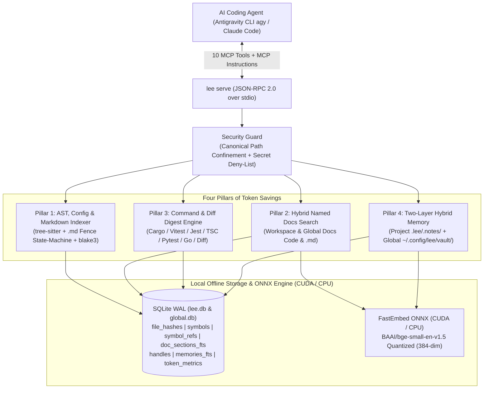

# `lee` — Locate Exact Elements

**Local Token-Saving MCP Server, Multi-Language AST & Markdown Section Indexer, Output Digest Engine (`h:ID`), and `BAAI/bge-small-en-v1.5` Hybrid Memory Store for AI Coding Agents.**

`lee` is a single standalone Rust binary engineered to **cut token consumption by 60%–85%** across long coding sessions in **Antigravity CLI (`agy`)**, **Claude Code**, and other Model Context Protocol (MCP) clients—without sacrificing context accuracy and with **zero network calls at query time**.

---

## 1. Overview & Philosophy: Four Pillars of Token Savings

AI coding agents routinely burn tens of thousands of tokens reading entire source files, scrolling through thousand-line Markdown docs, or ingesting verbose compiler/test logs. `lee` eliminates that waste through **Four Pillars**:

1. **Pillar 1 — Precision Code AST, Config & Markdown Section Index (`tree-sitter` + Markdown State-Machine + `blake3` Lazy Indexing):**
   Extracts symbol signatures (`fn`, `struct`, `enum`, `trait`, `impl`, `interface`, `class`, `type`, `mod`, `const`, `macro`) for Rust, TypeScript/JS, Svelte (`<script>` with `line_offset`), Python, and Go; key/table ranges for `.toml`, `.yml`/`.yaml`, and `.json`; and `#`–`####` headings for `.md`/`.mdx` (fence-aware so `#` comments inside ```` ``` ```` / `~~~` code blocks are ignored). Files are only re-parsed when their `blake3` hash changes.
2. **Pillar 2 — Hybrid Documentation & External Docs Search (`doc_sections` SQLite FTS5 BM25 + `BAAI/bge-small-en-v1.5`):**
   Splits Markdown files across the workspace and named workspace/global docs (registered via `lee add-docs`, supporting both code and `.md` libraries) into coalesced & overlapping window chunks, indexing them with SQLite FTS5 (multi-term AND-boosted BM25) and 384-dim `BGESmallENV15Q` vectors (with **CUDA** GPU acceleration and automatic CPU fallback). Target specific named docs or scopes directly via `search_docs(query="...", doc="gpui kit", scope="global"|"workspace")`.
3. **Pillar 3 — Output Digest & Handle Store (`h:ID` + ANSI Strip & Never-Worse Guard):**
   Executes shell/build/test/diff commands (`cargo`, `nextest`, `vitest`, `jest`, `tsc`, `pytest`, `go test`, `kaye diff`, `git diff`) through `run_digest`. ANSI escape sequences are stripped, compact output never exceeds raw size (*never-worse* invariant), and outputs > 35 lines are saved to SQLite under a short handle (`h:<6-char-blake3>`). Specific failing tests or per-file diffs can be retrieved via `recall(key="h:ID", item="NAME")`.
4. **Pillar 4 — Two-Layer Memory, `[[wikilinks]]`, Handoff & Backlog (`SQLite FTS5 BM25` + `BGESmallENV15Q` via RRF):**
   Stores architectural rules, UI conventions, session handoffs, and work backlogs in append-only Markdown files (`.lee/.notes/` + auto-generated `.lee/.notes/INDEX.md` for **Project Layer**, and `~/.config/lee/vault/` for **Global User Layer**), featuring 1-hop `[[wikilinks]]` expansion and hybrid Reciprocal Rank Fusion (RRF) with `cos_floor = 0.53`.

---

## 2. Architecture Diagram



---

## 3. Token Usage Comparison

| Workflow Scenario | Without `lee` (Raw Context) | With `lee` (MCP Tools) | Estimated Savings |
| :--- | :--- | :--- | :--- |
| **Cold Start / Codebase Onboarding** | Reading 10–20 raw source & README files (~18,000 tokens) | `project_map` + `recall_memory` (~750 tokens) | **~95%** |
| **Reading a Specific Function / Struct** | Reading an entire 600-line file (~4,500 tokens) | `outline` + `read_symbol` for lines `[42..88]` (~380 tokens) | **~91%** |
| **Refactoring / Tracing Callers & Type Deps** | `grep` + opening multiple files to check caller context (~5,000 tokens) | `find_references(symbol="...")` via AST `symbol_refs` (~180 tokens) | **~96%** |
| **Searching Large `.md` Documentation** | Reading a 1,200-line guide in full (~9,000 tokens) | `search_docs(query="...", budget_tokens=800)` (~600 tokens) | **~93%** |
| **Cross-Project Pattern Search** | Raw `grep` + opening files to check enclosing functions (~3,200 tokens) | `smart_grep` grouped by file with `[in fn ... (A..B)]` (~450 tokens) | **~85%** |
| **Running `cargo test` / `vitest` / `kaye diff`** | 1,500 lines of compiler/test/diff output (~12,000 tokens) | `run_digest` stores `h:8f2a9c` + `recall(item="...")` (~350 tokens) | **~97%** |
| **Recalling Project Conventions** | Re-explaining rules or loading entire rulebooks (~2,500 tokens) | `remember` + `recall_memory(budget_tokens=600)` (~400 tokens) | **~84%** |

---

## 4. Installation, Initialization & MCP Setup

### A. Install from Source
```bash
cargo install --path .
```

### B. Initialize Workspace & Embedding Model
Run inside your project root:
```bash
# Initialize .lee/, .lee/.notes/, PreToolUse hook plugin, SQLite WAL, and download BGESmallENV15Q once:
lee init

# (Optional) Skip model download when offline (gracefully falls back to SQLite FTS5 BM25):
lee init --skip-model
```
*(Note: `lee init` automatically installs the Antigravity `PreToolUse` hook plugin and keeps `.agents/plugins/lee/rules/AGENTS.md`, `~/.config/lee/AGENTS.md`, and any `<!-- lee:start -->...<!-- lee:end -->` block inside `./AGENTS.md` or `./CLAUDE.md` up to date whenever `lee` is upgraded to a new version.)*

### C. Manage Workspace & Global Docs (`add-docs`, `docs` & `rm-docs`)
Register named external reference libraries or documentation folders (both source code `.rs`/`.ts`/`.py`/`.go` and `.md` docs) for the current workspace (`--w`, default) or globally across all workspaces (`--g`):
```bash
# Register a workspace doc (prompts interactively for a name, e.g. "gpui kit"):
lee add-docs /home/user/Projects/gpui-kit_docs
lee add-docs --w /home/user/Projects/gpui-kit_docs

# Register a global doc (available in every workspace) or pass --name directly:
lee add-docs --g /home/user/Projects/gpui-kit_docs
lee add-docs --g /home/user/Projects/gpui-kit_docs --name "gpui kit"

# List all registered workspace and global docs (with names & paths):
lee docs

# Machine-readable JSON output for LLMs and scripts:
lee docs --json

# Remove a doc via interactive numbered menu (or by name, number, path, or --all):
lee rm-docs
lee rm-docs "gpui kit" --g
lee rm-docs 1
lee rm-docs --w --all
```
Once registered, you can mention docs by name in prompts (e.g. *"cek docs gpui kit"*, *"cek docs gpui kit dari global"*, or *"cek docs gpui kit di workspace ini"*) and the agent will resolve them via `lee docs --json` and `search_docs(query="...", doc="gpui kit", scope="global"|"workspace")`.

### D. MCP Configuration for Antigravity CLI (`agy`)
Add `lee` to your global Antigravity configuration at `~/.gemini/config/mcp_config.json`:

```json
{
  "mcpServers": {
    "lee": {
      "command": "lee",
      "args": ["serve"]
    }
  }
}
```

### E. MCP Configuration for Claude Code
Add to `.mcp.json` in your project root or `~/.claude.json`:

```json
{
  "mcpServers": {
    "lee": {
      "type": "stdio",
      "command": "lee",
      "args": ["serve"]
    }
  }
}
```

---

## 5. Complete Reference: 10 MCP Tools & CLI Commands

### 10 MCP Tools

| # | Tool Name | Key Parameters | Purpose |
| :-: | :--- | :--- | :--- |
| 1 | `project_map` | `subpath?`, `max_tokens?` (def: `800`) | Parallel codebase & Markdown scan returning prioritized directory trees, AST symbols, `#` headings, and `[start..end]` ranges. |
| 2 | `outline` | `file`, `max_tokens?`, `include_tests?` | Complete symbol table (code), `#` Heading TOC (`.md`), or config key ranges (`.yml`/`.toml`/`.json`) for one file. |
| 3 | `read_symbol` | `file?`, `symbol?`, `start_line?`, `end_line?`, `context_lines?`, `strip_comments?`, `signatures_only?`, `max_lines?` | Precision line-range reader for symbols (across workspace if `file` omitted), Markdown sections, or config keys with pagination, comment stripping, & AST `signatures_only` mode. |
| 4 | `find_references` | `symbol` | Queries AST `symbol_refs` (`call`, `type_use`, `import`) to list every caller function and file referencing a symbol across the workspace. |
| 5 | `search_docs` | `query`, `doc?`, `scope?` (`"workspace"` / `"global"` / `"all"`), `file_filter?`, `budget_tokens?` (def: `800`) | Hybrid search (FTS5 BM25 + `BGESmallENV15Q` RRF) across workspace & global named docs Markdown sections. |
| 6 | `smart_grep` | `pattern`, `path?`, `glob?`, `files_only?`, `case_insensitive?`, `max_per_file?`, `max_results?` | Replaces `rg -l` / `rg -n`: file-grouped regex matches (with directory prefix folding on `files_only=true`) annotated with enclosing AST symbols or Markdown headings. |
| 7 | `run_digest` | `command`, `cwd?` | Runs shell/build/test/diff commands; groups `cargo clippy` rules, compacts `git status`/`git log`, respects `--nocapture`, enforces *never-worse*, and saves logs > 35 lines under `h:ID`. |
| 8 | `recall` | `key`, `item?`, `failures_only?`, `filter?`, `start_line?`, `end_line?` | Pulls a single test/symbol/file-diff block (`item`), failure blocks, regex-filtered context, or line ranges from `h:ID`. |
| 9 | `remember` | `topic`, `content`, `tags?`, `scope?` (`"project"` / `"global"` / `"handoff"` / `"backlog"`) | Appends decisions, session handoffs, or backlog items to Markdown (`.lee/.notes/`, `INDEX.md`, or `vault/`) with `[[wikilinks]]`. |
| 10 | `recall_memory` | `query`, `budget_tokens?` (def: `600`) | Hybrid RRF recall (`cos_floor = 0.53`) across project, global, handoff, & backlog memories + 1-hop `[[wikilinks]]` expansion. |

### CLI Commands (`lee`)

```bash
lee init [--global] [--skip-model]               # Initialize .lee/, PreToolUse hook, SQLite DB, & BGE-Small model
lee exec <COMMAND...>                            # Execute a shell command and compress its output via run_digest
lee docs [--json]                                # List registered workspace & global docs (`--json` for LLMs)
lee add-docs <PATH> [--w|--g] [--name <NAME>]    # Register a named workspace (`--w`) or global (`--g`) docs dir
lee rm-docs [NAME|PATH|NUM|--all] [--w|--g]      # Remove a registered doc (supports interactive numbered menu)
lee index                                        # Scan & pre-index all code, config, and Markdown files (+ BGE vectors) in parallel
lee status                                       # Show index counts, BGE model cache status, and registered docs
lee stats [--daily] [--history]                # Display token-savings audit table, daily ASCII chart, and call history
lee discover [PATH]                            # Scan AI session transcripts (.jsonl) for bypassed raw commands & missed savings
lee backlog                                    # List latest Session Handoffs and aging Work Backlog items
lee undo [-y]                                  # Remove .lee/ DB/config files while preserving .lee/.notes/
lee hook <antigravity|claude|prompt|digest>    # PreToolUse command-rewriting hook or prompt/stdin interceptor
lee serve                                      # Run the JSON-RPC 2.0 MCP server over stdin/stdout
```

---

## 6. Security Model (*Hardcoded Security Guard*)

1. **Zero Network Calls at Query Time:**
   When running as an MCP server (`lee serve`) or executing queries, `lee` makes **zero network requests**. The `BAAI/bge-small-en-v1.5` (`BGESmallENV15Q`) ONNX model is loaded directly from local snapshot files in `~/.config/lee/models` via `UserDefinedEmbeddingModel` (bypassing `hf-hub`). If the model has not been downloaded yet, queries gracefully fall back to SQLite FTS5 BM25.
2. **Canonical Path Confinement:**
   Every file access is validated lexically and via canonical symlink resolution (`std::fs::canonicalize`), with `~/` expansion. Any path escaping the project root or registered `sources` is rejected.
3. **Hardcoded Secret Deny-List (`GlobSet`):**
   Blocks indexing, reading, grepping, and `run_digest` execution for sensitive files:
   - `.env`, `.env.*`, `**/.env*`
   - `*.pem`, `*.key`, `*.p12`, `*.pfx`
   - `id_rsa*`, `id_ed25519*`
   - `*secret*`, `*credentials*`
